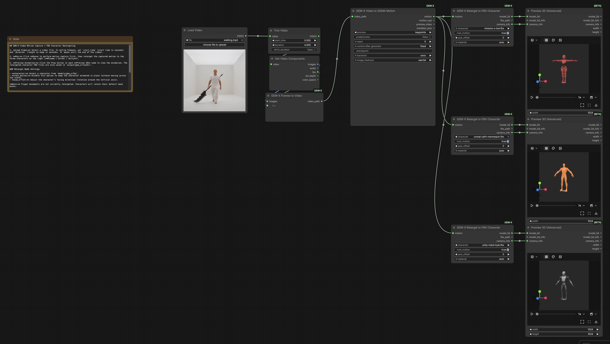

# ComfyUI-GEM-X

English | [中文](README_CN.md)

Whole-body motion capture from a single video in ComfyUI with NVIDIA [GEM-X](https://github.com/NVlabs/GEM-X) (SOMA body, 77 joints), plus retargeting onto Mixamo / Unreal / Unity FBX characters that play back right in ComfyUI's built-in 3D preview.

Video → person tracking → ViTPose 77 keypoints → SAM-3D-Body features → GEM → SOMA motion → animated FBX character.



*The workflow is embedded in this image: drag it into ComfyUI to open it. The same workflow is in [example_workflows/](example_workflows).*

## Installation

Requires an NVIDIA GPU with CUDA. Run the commands below with ComfyUI's own Python.

**1. Clone this repository into ComfyUI's `custom_nodes` directory:**

```bash
cd ComfyUI/custom_nodes
git clone https://github.com/lkevincc0/ComfyUI-GEM-X.git
```

**2. Install dependencies:**

```bash
cd ComfyUI-GEM-X
pip install -r requirements.txt
python install.py
```

`install.py` creates the plugin's own inference environment `.venv` (reusing ComfyUI's installed PyTorch), installs the inference dependencies from `requirements-worker.txt`, and unpacks the three bundled characters (with textures) into `ComfyUI/models/gem_x/fbx/`. ComfyUI-Manager runs this step automatically when installing from the Git URL.

**3. Restart ComfyUI.** The nodes appear under the `GEM-X` category. Example workflows are in `example_workflows/` and can be dragged straight into ComfyUI.

Optional environment variables: `GEM_X_PYTHON` points inference at an existing Python environment (also set `GEM_X_SKIP_VENV=1` to skip creating `.venv`); `COMFYUI_MODELS_DIR` sets a non-default models directory.

## Models

Models download automatically to `ComfyUI/models/gem_x/` on first use, and only the files the selected mode needs. Downloads come from HuggingFace first, fall back to the ModelScope mirror, and resume if interrupted.

| Model | Purpose | Size | Needed for |
|---|---|---:|---|
| YOLOX-X HumanArt | Person detection | 370 MB | All modes |
| SOMA body assets + scale data | Body model, retargeting | 130 MB | All modes (incl. retarget node) |
| ViTPose (ONNX) | 77-point 2D keypoints | 3.4 GB | `onnx` |
| GEM denoiser (ONNX) | Motion regression | 200 MB | `onnx` + `sam3d` |
| SAM-3D-Body backbone (ONNX) | Image features | 3.4 GB | `onnx` + `sam3d` |
| SAM-3D-Body checkpoint + MHR | Image feature decoding | 2.8 GB | `sam3d`, `pytorch` |
| GEM denoiser no-imgfeat (ONNX) | Motion regression without image features | 1.3 GB | `onnx` + `keypoints_only` |
| GEM checkpoint + ViTPose (PyTorch) | PyTorch backend | 3.9 GB | `pytorch` |

The default mode (`backend=onnx`, `image_features=sam3d`) needs about 9.8 GB. To download ahead of time:

```bash
python -m comfyui_gem_x.models /path/to/ComfyUI/models/gem_x          # default mode
python -m comfyui_gem_x.models /path/to/ComfyUI/models/gem_x --all    # every mode
```

The full file list and manual download links are in [docs/COMFYUI_ONNX_MODELS.md](docs/COMFYUI_ONNX_MODELS.md) (Chinese).

## Nodes

| Node | Description |
|---|---|
| **GEM-X Video to SOMA Motion** | Video → SOMA motion. Outputs `motion`, `motion.npz`, a keypoint preview video and a result manifest; the node plays the preview and links the downloads. |
| **GEM-X Retarget to FBX Character** | Retargets `motion` onto a character in `models/gem_x/fbx/`. Outputs `FILE_3D_FBX`, the FBX path and camera settings; connect it to the built-in **Preview 3D (Advanced)** to play it. |
| **GEM-X Frames to Video** | Encodes an `IMAGE` frame batch into a temporary MP4, e.g. from a video generation node. |
| **GEM-X Video Path** | Takes a video path (absolute, or relative to `input/`). |

The example workflow: Load Video → Trim Video (pick a segment) → motion capture → three characters, each retargeted and previewed.

### Inference options

- `backend`: `onnx` by default; `postprocess` (contact/translation post-processing) requires `pytorch`.
- `image_features`: `sam3d` uses image features; `keypoints_only` skips SAM3D and downloads less, but compare the results yourself.
- `preview`: `none` / `keypoints` / `mesh` (mesh needs Open3D/EGL).
- Only the main tracked person is processed; the camera is treated as static; the input frame rate is kept, so convert variable-frame-rate videos to a constant rate first.

### Retargeting

- Rigs are detected by bone names: Mixamo (with or without the `mixamorig:` prefix), Unreal UE4/UE5/UEFN humanoids, and Unity Robot Kyle. Y-up/Z-up and T-pose/A-pose are aligned automatically.
- Spine, head, arms, legs and toes are mapped; fingers, twist bones and IK bones keep the character's rest pose. Root motion is scaled by leg length; turn off `root_motion` to animate in place; `yaw_offset` rotates the heading.
- `material=auto` looks for textures by file name next to the FBX (subfolders included) and embeds them in the output FBX (TGA etc. converted to PNG); if none are found it uses solid orange. Other choices: `original` / `red` / `orange` / `gray` / `blue`.
- Bundled characters: Mixamo X Bot, the UEFN mannequin (no textures, orange by default) and Unity Robot Kyle (with its color texture). Put a new `.fbx` in `models/gem_x/fbx/` (a subfolder can hold its textures) to pick it from the dropdown.
- After export the animation is read back and checked (rotation error > 1° raises an error). This only guarantees the keys were written correctly; judge the motion itself in the preview.

## Output format

`motion.npz` loads with `numpy.load(path, allow_pickle=False)` and contains `body_params_incam/<param>`, `body_params_global/<param>`, `K_fullimg`, `fps` and `frame_count`. Translation is in meters and poses use the SOMA axis-angle representation. `hpe_results.pt` keeps the original upstream prediction.

## Tests

```bash
./.venv/bin/python -m unittest discover -s tests -v
```

Tests cover worker calls, errors, cancellation, API and WebSocket forwarding, video range responses, ZIP contents and BVH rotation round-trips. Model accuracy and GPU execution require separate end-to-end validation.

## Credits and license

Built on NVIDIA [GEM-X](https://github.com/NVlabs/GEM-X), with [SOMA-X](https://github.com/NVlabs/SOMA-X) and [SAM-3D-Body](https://github.com/facebookresearch/sam-3d-body) vendored in `third_party/` (with small compatibility fixes). The retargeting approach was inspired by [ComfyUI-Kimodo](https://github.com/jtydhr88/ComfyUI-Kimodo).

Source code is under [Apache 2.0](LICENSE); third-party components are listed in [ATTRIBUTIONS.md](ATTRIBUTIONS.md) and the LICENSE files under `third_party/`. Model weights are under the [NVIDIA Open Model License](https://www.nvidia.com/en-us/agreements/enterprise-software/nvidia-open-model-license/). The characters in `assets/characters.zip` come from Adobe Mixamo, Epic Games (UEFN) and Unity, and each is subject to its platform's terms of use.

```bibtex
@inproceedings{genmo2025,
  title     = {GENMO: A GENeralist Model for Human MOtion},
  author    = {Li, Jiefeng and Cao, Jinkun and Zhang, Haotian and Rempe, Davis and Kautz, Jan and Iqbal, Umar and Yuan, Ye},
  booktitle = {Proceedings of the IEEE/CVF International Conference on Computer Vision (ICCV)},
  year      = {2025}
}
```
